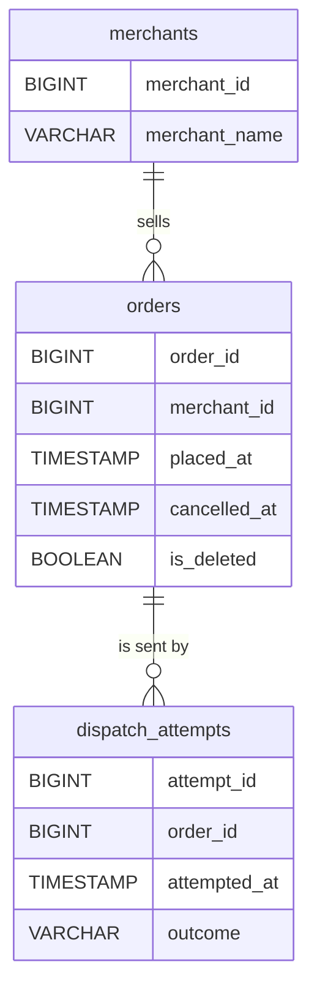
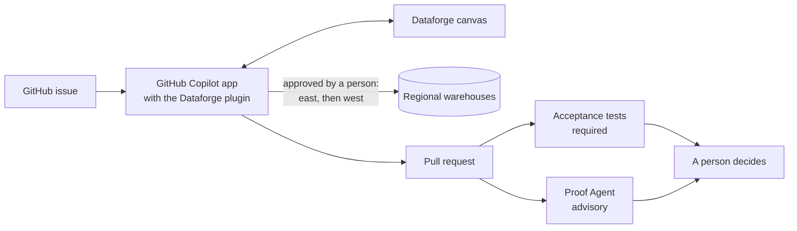

# Build once, run on any agent — Madrid demo

[](slides/talk.pdf)

**A practical guide to agent skills** · GitHub Universe 2026 · BLD1787B

This is a fork of
[githubevents/build-once-run-on-any-agent](https://github.com/githubevents/build-once-run-on-any-agent),
prepared for Universe on the Road Madrid 2026. The original talk materials are
unchanged. This fork adds **one runnable demo** that joins the talk's two
examples into a single story: Dataforge builds a data pipeline in the GitHub
Copilot app, and Proof Agent reviews the resulting pull request.

This Madrid adaptation is by Marta Lacasta, based on the original session by
Andrea Griffiths and Shishir Tewari and the Sydney demo adaptation by Kartik
Gupta.

## Madrid Slides

Link to powerpoint: https://onedrive.cloud.microsoft/:p:/a@3r498cu9/S/cQqhi-uycg__Q7nv0AJu00nkEgUD0zVvpFCIbtIgpvepw04Ejg

## The point to land

Every organisation has a pipeline unique to their use case. Procore created one that captures their institutional knowledge. The audience needs to do the same for their organisations and can use Dataforge as an example of a framework to capture this knowledge for agents.

## The demo in 30 seconds

A fictional online marketplace promises that every order leaves a
fulfilment centre within 48 hours. Operations asks a simple-sounding question
in a GitHub issue:

> How many orders missed our 48-hour dispatch promise, by merchant, in each region?

1. **Copilot builds it with Dataforge.** In the GitHub Copilot app, Shishir
   Tewari's four Dataforge skills — unchanged — learn how this team builds
   metrics, check the issue's business rules against the data, and stop for a
   person twice: to approve the metric design, and to approve the deploy. Then
   they deploy to Madrid Este then Madrid Oeste, and open a pull request.
2. **A canvas shows what is happening.** A side panel in the Copilot app shows
   the question, the build and the results, read from real files.
3. **Someone else checks the work.** On the pull request, human-owned
   acceptance tests (required) and Andrea Griffiths' Proof Agent (an advisory
   AI review) run in GitHub Actions. A person decides whether to merge.

The scripted walkthrough is
[`demos/dataforge/examples/online-marketplace/DEMO.md`](demos/dataforge/examples/online-marketplace/DEMO.md).

**A Sydney reference rehearsal run** is [octodemo/build-once-run-on-any-agent#4](https://github.com/octodemo/build-once-run-on-any-agent/pull/4).
Copilot built it with the unchanged Dataforge skills from
[octodemo/build-once-run-on-any-agent#3](https://github.com/octodemo/build-once-run-on-any-agent/issues/3).
The acceptance tests pass in both regions. Proof Agent's advisory review
returned FAIL, flagging how the pipelines insert dates into SQL — a real
concern for a person to weigh, not a scripted one. It stays open, unmerged, so
`main` keeps the starting state for the live demo.

## The story

The promise sounds simple, but the edge cases are where reports go wrong. One
merchant, Harbour Homewares, joined last week, so every one of its orders can be
checked by hand. Day 7 is yesterday; all times use Madrid local time.

| Order | What happened | Promise |
| --- | --- | --- |
| 101 | Placed day 1, dispatched 29 hours later | **Met** (day 2) |
| 102 | Placed day 1, one failed attempt, still waiting | **Missed** (day 3) |
| 103 | Placed and cancelled on day 1 | Not counted: cancelled in time |
| 104 | Placed yesterday | Not due yet |
| 105 | Placed day 1, two failed attempts, dispatched after 68 hours | **Missed** (day 3), counted once |
| 106 | Placed day 2, cancelled on day 5, after its deadline | **Missed** (day 4) |
| 107 | A test order | Ignored |

The agreed rules: dispatched within 48 hours means the promise was met. Not
dispatched when the 48 hours run out means it was missed, even if the order
ships later. Cancelling before the deadline means it doesn't count. Several
dispatch attempts are still one order. Test orders are ignored.

## The data model, simply

Each region has its own small warehouse — a DuckDB file on your laptop. Both
have the same three source tables.



- **`merchants`**: the businesses that sell on the marketplace. 12 in `east`
  (Madrid Este) and 6 in `west` (Madrid Oeste).
- **`orders`**: one row per order — who sold it, when it was placed, and when it
  was cancelled, if it was. `is_deleted` marks test orders.
- **`dispatch_attempts`**: one row every time a fulfilment centre tries to send
  an order. `outcome` is `failed` or `dispatched`. An order that failed twice
  before it went out has three rows, which is exactly where double counting
  creeps in.

The pipeline turns those rows into **metrics**: one number per merchant, per
day. Every metric table has the same shape:

| Column | Meaning |
| --- | --- |
| `SNAPSHOT_DATE` | The day the number is for |
| `merchant_id` | Which merchant (the *grain*: what each number is broken down by) |
| `metric_name` | What is being counted, for example `total_dispatch_miss_count` |
| `metric_value` | The count |
| `LOAD_TIMESTAMP`, `SOURCE_ZONE` | When it was loaded, and from which region |

Each metric comes in two *cadences*. **Daily** counts what happened on that
day; **cumulative** counts everything up to and including it. For Harbour
Homewares, the daily missed count is 2 on day 3 and 1 on day 4, so the
cumulative count on day 4 is 3.

| Metric tables | Status |
| --- | --- |
| `Order_Merchant_Metrics_Snapshot_Daily` and `_Cumulative`: orders placed and cancelled | Already built: the "house style" Dataforge learns from |
| `Dispatch_Merchant_Metrics_Snapshot_Daily` and `_Cumulative`: promises met and missed | Built live in the demo |

## How the demo works



| Piece | In plain English | Where |
| --- | --- | --- |
| **Agent skill** | A folder of instructions and helper files an agent loads when a task needs it. An open standard. | [`demos/dataforge/skills/`](demos/dataforge/skills/) |
| **Dataforge** | Four skills that turn a request into a metric pipeline: learn the project, talk to the warehouse, apply the house rules, run the seven build phases. None of them knows anything about this marketplace. | [`demos/dataforge/`](demos/dataforge/) |
| **Manifest** | The one file holding everything specific to this business: regions, tables, naming, the words *meet* and *miss*. | [`dataforge.manifest.yaml`](demos/dataforge/examples/online-marketplace/dataforge.manifest.yaml) |
| **Plugin** | Dataforge's package: the same one Claude Code and Cursor install. This repository's settings enable it in Copilot, for this repository only. | [`.github/copilot/settings.json`](.github/copilot/settings.json) |
| **Canvas** | A side panel in the Copilot app that shows the question, the build and the proof, from real files. It's the Copilot-specific part; the skills don't know it exists. | [`.github/extensions/dataforge-canvas/`](.github/extensions/dataforge-canvas/) |
| **Acceptance tests** | Human-owned checks. They compute the expected numbers from the agreed rules, independently of the pipeline. Required to merge. | [`acceptance/`](acceptance/) |
| **Proof Agent** | Andrea Griffiths' verifier skill, run by GitHub Actions through the Copilot SDK. It reviews the diff and gives a PASS, FAIL or PARTIAL verdict with evidence. Advisory. | [`.github/workflows/proof-agent.yml`](.github/workflows/proof-agent.yml) |

## Run it yourself

You need the GitHub Copilot app, the GitHub CLI, the DuckDB CLI and Python 3.9+.

```bash
gh repo clone octodemo/build-once-run-on-any-agent-madrid
cd build-once-run-on-any-agent-madrid
gh repo set-default octodemo/build-once-run-on-any-agent-madrid
cd demos/dataforge/examples/online-marketplace
python3 seed.py                                   # builds the two regional warehouses
python3 ../../../../acceptance/online-marketplace/acceptance.py   # checks the starting state
```

Then open the repository in the GitHub Copilot app, ask Copilot to *"Open the
Dataforge canvas"*, and follow [DEMO.md](demos/dataforge/examples/online-marketplace/DEMO.md).
To try Dataforge without the app, use Copilot CLI with
`copilot --plugin-dir demos/dataforge`.

## What is real, and what isn't

- **Real:** the Dataforge skills, unchanged; Copilot running them; the DuckDB
  queries; the generated code; the pull request; the GitHub Actions runs; and
  whatever Proof Agent says.
- **Synthetic:** all of the data. Every merchant, order and customer is
  fictional and generated from a fixed seed.
- **Local:** the warehouses are DuckDB files on a laptop, not a production
  platform. Nothing is deployed anywhere real.
- **Not claimed:** time savings, or that Proof Agent will catch any particular
  problem. The demo shows a process, not a benchmark.

## Repository layout

| Path | Contents |
| --- | --- |
| [`demos/dataforge/examples/online-marketplace/`](demos/dataforge/examples/online-marketplace/) | **The Madrid demo project:** data, existing pipeline, issue, run guide and reset script |
| [`acceptance/`](acceptance/) | Human-owned acceptance tests for the demo |
| [`.github/`](.github/) | Copilot settings and plugin marketplace, the Dataforge canvas, and the workflows for the acceptance tests and Proof Agent |
| [`demos/`](demos/) | The talk's skills, as runnable snapshots |
| [`slides/`](slides/) | The original talk deck |
| [`assets/`](assets/) | Recordings used by the original demos and the site |
| [`site/`](site/) | Talk website source (its deployment workflow is disabled in this fork) |

## About the original talk

| Speaker | Role |
| --- | --- |
| Andrea Griffiths | Senior Developer Advocate, GitHub |
| Shishir Tewari | Senior Manager, Data Engineering, Procore |

[Talk site](https://gh.io/skills-talk) · [Slides (PDF)](slides/talk.pdf) · [Session summary (PDF)](assets/session-summary.pdf)

Most developers use AI the same way: open a chat, type a prompt, move on. The context disappears. The next step starts from scratch.

Agent skills fix that. Andrea Griffiths builds them for her own recurring work: files any coding agent can run. Shishir Tewari builds them for a data engineering team at Procore, where a skill has to encode senior-engineer judgment and survive production.

Different scale, same format. The file you write for yourself tonight is the same file that runs a team’s pipeline.

| Skill | What it does | Media | Source |
| --- | --- | --- | --- |
| [**proof-agent**](demos/proof-agent/) | Andrea's independent verifier skill and GitHub Action, pinned to `v1.1.2` | [Narrated demo](assets/recordings/proof-agent-narrated.mp4) (3:43) | [AndreaGriffiths11/proof-agent](https://github.com/AndreaGriffiths11/proof-agent) |
| [**dataforge**](demos/dataforge/) | Shishir's four agent skills that build data pipelines from a project manifest, issue to pull request | [Recording](assets/recordings/Dataforge.mp4) | [tewarishishir/dataforge](https://github.com/tewarishishir/dataforge) |

[**proof-review**](demos/proof-review/) is not part of the talk. It extends the verifier idea from proof-agent: proof-agent reviews the diff, proof-review reproduces a bugfix claim under production-shaped load and measures whether the PR closes every root cause. Canonical: [AndreaGriffiths11/proof-review](https://github.com/AndreaGriffiths11/proof-review).

The eight-page session summary is AI-generated by VOXO. For more of Andrea's skills and resources, see [mainbranch.dev/skills](https://mainbranch.dev/skills/).

## Licence and credits

- **Code** (site, scripts, and this fork's demo code): [MIT](LICENSE)
- **Slides, recordings, and written content**: [CC BY 4.0](LICENSE-CONTENT). Reuse is welcome with credit to Andrea Griffiths and Shishir Tewari.
- **Demos** keep their own licences: [proof-agent](demos/proof-agent/LICENSE), [dataforge](demos/dataforge/LICENSE), [proof-review](demos/proof-review/LICENSE).

Dataforge is by Shishir Tewari; Proof Agent is by Andrea Griffiths. Both are
used here unchanged.
